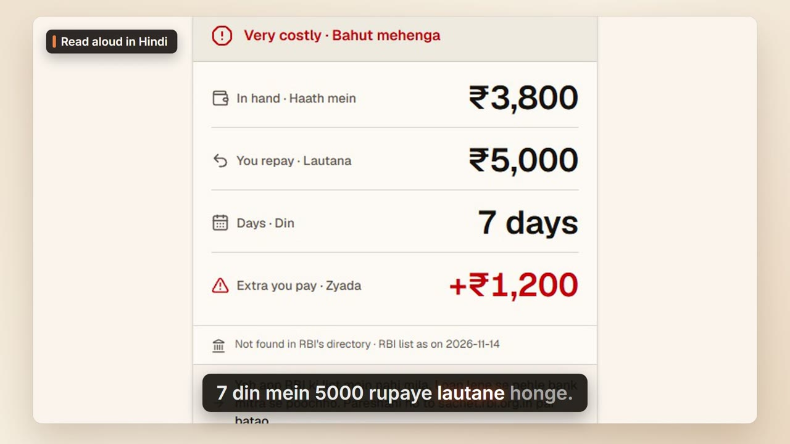
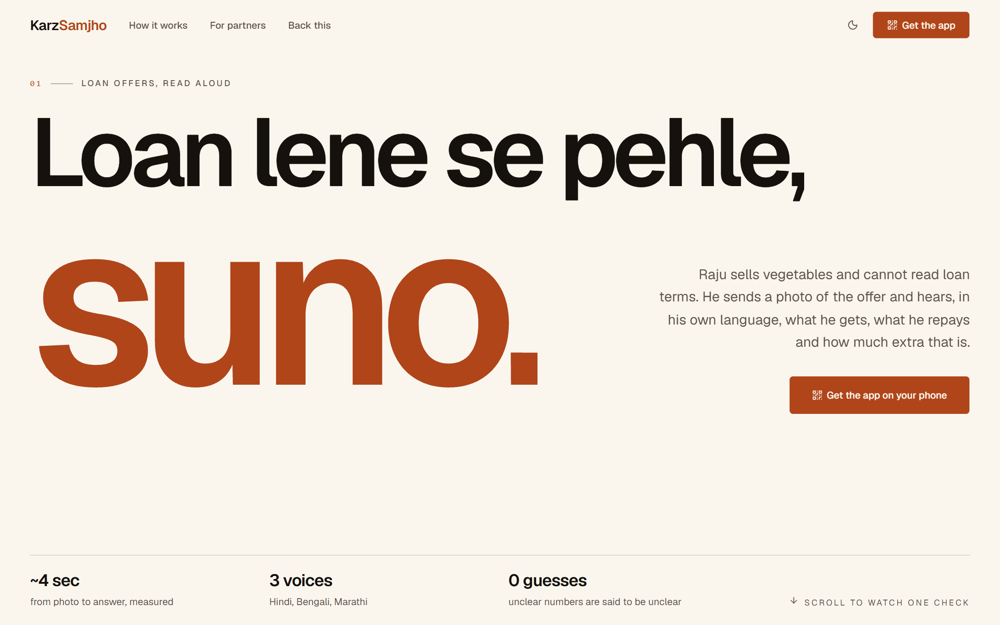
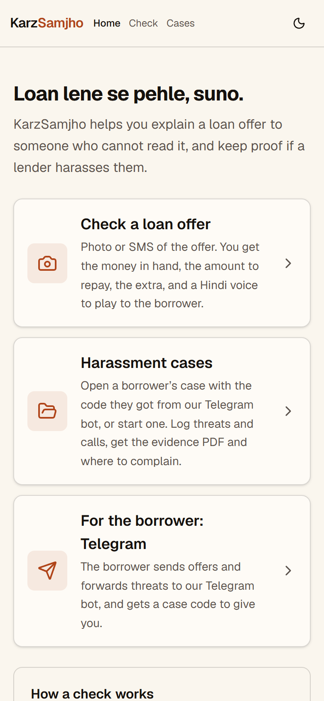
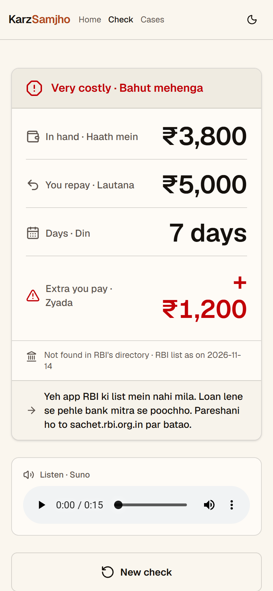
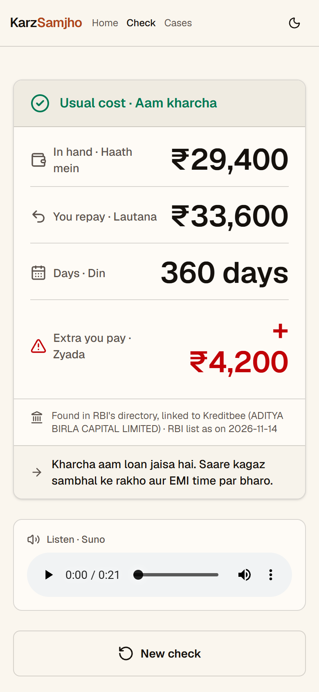
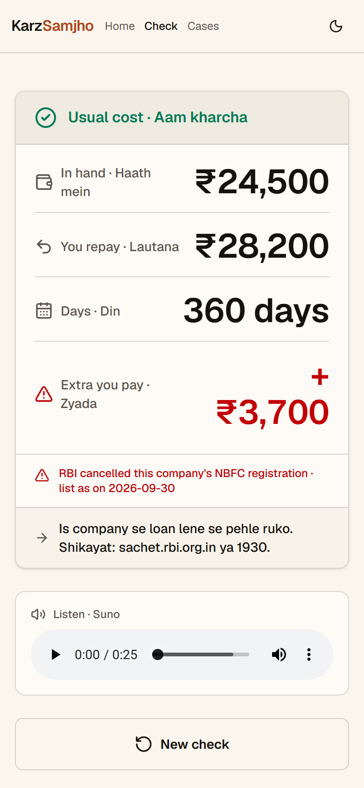
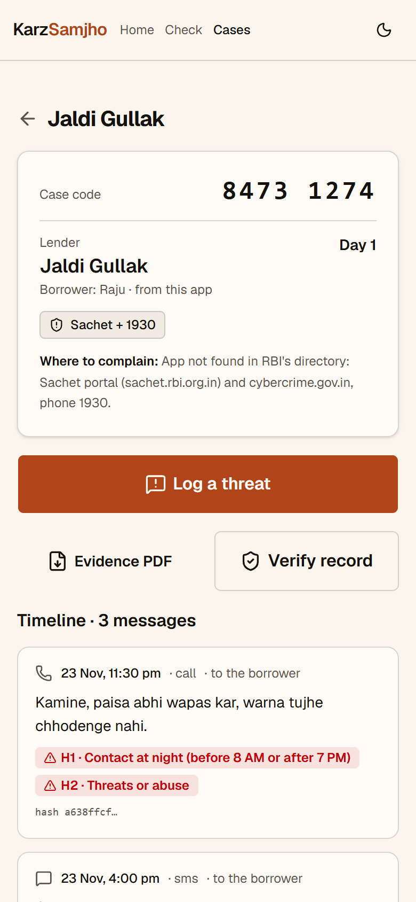
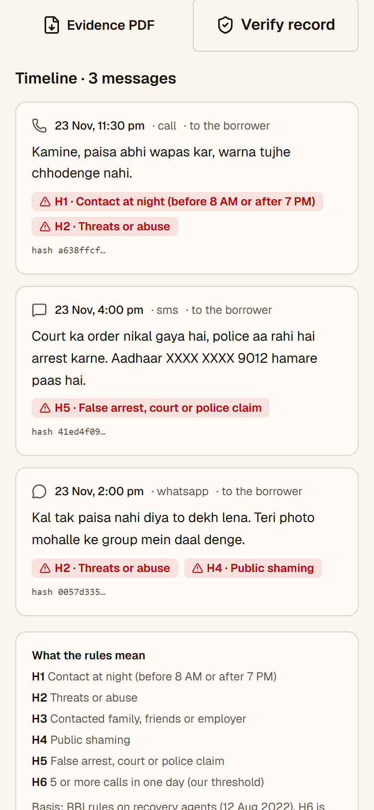
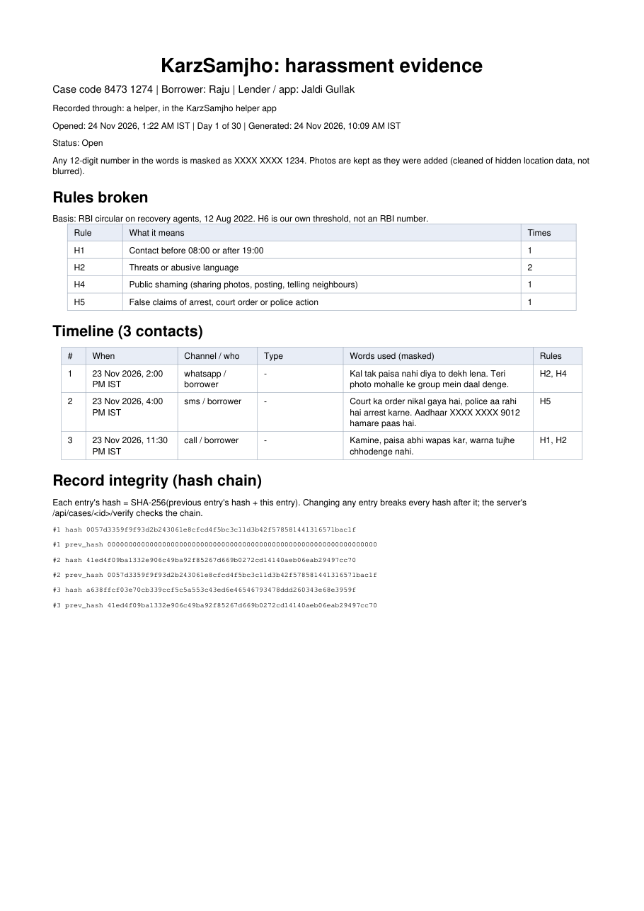

# KarzSamjho

**Loan lene se pehle, suno.** (Before you take a loan, listen.)

Send a photo of a loan offer (or paste the SMS) and hear, in Hindi, what you get, what you repay and how much extra that is. If a lender is harassing you, turn the messages and calls into a dated evidence file with the right place to complain.

Built by Team Y2K Devs at COLOSSUS 3.0 (13-14 Nov 2026), FinTech track.

Hackathon version: see tag `colossus-submission` (COLOSSUS 3.0, 13-14 Nov 2026). Work after that tag is post-hackathon.

**New here? Read [docs/START_HERE.md](docs/START_HERE.md) first.**

## Try it
- Website and helper app: https://karzsamjho.vercel.app (the helper app's home is at `/app`; it can be installed from there. On a laptop the website shows a QR for the phone)
- API health: https://karzsamjho-api.onrender.com/api/health (free tier: the first call after a pause can take up to a minute)
- Telegram bot: https://t.me/karzsamjho_demo_bot (runs on Render next to the API; the first message after a pause can take up to a minute)

## Watch it (1 minute)

Click the picture to play the video (61 seconds, with captions): a photo of a loan offer becomes the rupee card and the Hindi voice, then the RBI list check, then a harassment case with its evidence PDF. Every offer and threat shown is a synthetic sample. The English narration is a generated copy of a teammate's own voice; the Hindi sentence is the app's own voice.

## Screenshots
Every offer and threat in these pictures is a synthetic sample.

**The website** (for funders and partners):

**Checking a loan offer** (the helper app on a phone):

| Home | A costly offer | A lender in RBI's list | A cancelled registration |
|---|---|---|---|
|  |  |  |  |
| What the helper can do | ₹3,800 in hand, ₹5,000 back in 7 days: ₹1,200 extra | "Found in RBI's directory", with the list date | A dated warning and one next step |

**Harassment log:**

| The case | Each threat and the rule it breaks | The evidence PDF |
|---|---|---|
|  |  |  |
| The 8-digit code, the lender and where to complain | Rules H1 to H6 named; a 12-digit ID is masked | Rules broken, dated timeline and the tamper check |

## What it does
- **Snap & hear:** photo, pasted SMS or a voice note in Telegram, or photo / SMS in the helper app -> a simple card + voice in Hindi, Bengali or Marathi (`/bhasha`); warns when an offer asks for money before the loan
- **Rupee receipt:** in hand, to repay, days, extra; maths in code, never by AI
- **Official next step:** is the app in RBI's directory of digital lending apps (by name and by website)? Spoken as well as shown, with the list date; a dated warning when RBI has cancelled the company's NBFC registration (exact name only); then one next action
- **Harassment log:** the borrower forwards threats to the bot and gets a private 8-digit case code (`/helper`); the helper opens the case with that code in the app, logs calls and messages (type of threat, up to 3 photos) -> RBI recovery-rule matches H1-H6 -> hash-chained record -> evidence PDF (evidence, complaint draft and photos, each part from its own page); a hand-edited record or a swapped photo fails "verify"; a finished case can be closed

## Who uses what
- **Borrower (Raju):** the Telegram bot. Send an offer, listen; forward threats; `/helper` gives the case code.
- **Helper (bank mitra, NGO, family):** the helper app on the phone (`/app`). Check an offer for someone, open a case with the code, log calls and photos, get the PDF, verify, close.
- **Funders and partners:** the website (`/`, `/how`, `/partners`, `/join`). On a laptop it shows a QR to open the app on a phone.

## How it works
A vision model reads the photo; plain Python checks the numbers and does the maths; a second model re-reads when numbers disagree; anything unclear is reported as "couldn't verify". Data lives in Postgres on Neon. See docs/ARCHITECTURE.md.

## Folders
- `api/`: the backend (FastAPI; Postgres on Neon when hosted, SQLite locally and in tests). All logic is in `api/core/`.
- `web/`: the public website (`/`, `/how`, `/partners`, `/join`) and the helper app (`/app`, `/check`, `/cases`): React, Vite, Tailwind, shadcn/ui.
- `bot/`: the Telegram bot.
- `scripts/`: setup and run scripts for Windows (`.bat`) and Mac/Linux (`.sh`).
- `docs/`: progress log, decisions, architecture, testing, demo script, runbook.

## Run it
See docs/START_HERE.md for setup and docs/RUNBOOK.md for fixes.

## Results
667 automated tests (no internet needed; CI on every pull request; the same suite also passes on Postgres). At the hackathon submission: 625.

Measured on 14 Nov 2026 with the real AI services, on the 15-offer demo pack we made ourselves (10 images + 5 SMS, expected answers written by hand first):
- Paced run (one photo every 25 s): 15 of 15 as expected, including 2 that must say "couldn't verify"; 0 wrong numbers shown as verified; median 2.3 s per check.
- A miss we found and fixed: in a faster run the backup model read a Hindi pamphlet's "₹50 हज़ार" as ₹50 and the card showed it as verified. A sanity rule now turns such a reading into "couldn't verify".
- Harassment samples: 5 of 5 get exactly the expected rules; the PDF masks the 12-digit number; a hand-edited record fails verify.
- Kill-switch drill: with a wrong Groq key the backup model answered a photo and an SMS in under 3 s; with voice off the card still arrives.

All rows: docs/TESTING.md. Team progress: `python scripts/show_progress.py`.

## Limits
Synthetic test offers only (RBI's lists are the real public files). No login: whoever has a case's 8-digit code can open it. Photos added to a case are not blurred. "Not found in RBI's directory" does not mean illegal; a cancelled registration is a dated fact, not an accusation. The cost bands are our own rule of thumb, not an RBI limit. Not tested with real users yet. Free AI tiers allow about 3 photos a minute; after that the backup model reads.

## Credits
Telegram Bot API, Groq (Qwen, gpt-oss-20b, Whisper), Google Gemini API, edge-tts, FastAPI, Pydantic, RapidFuzz, ReportLab, Pillow, psycopg, Neon, python-telegram-bot, React, Vite, Tailwind CSS, shadcn/ui, lucide-react, motion. Hosting: Vercel, Render, Neon. AI coding tools: Claude Code, Cursor.
